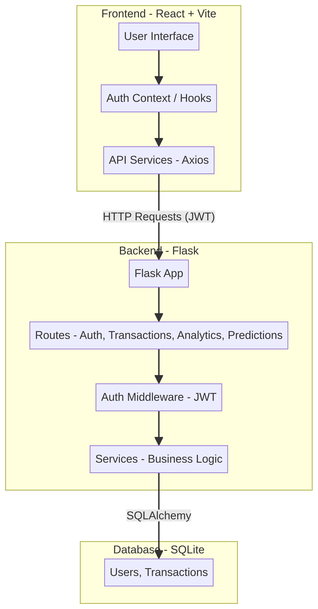

# 💰 Personal Finance Platform

A comprehensive full-stack personal finance tracking and forecasting application. This platform allows users to manage their income and expenses, visualize their financial health through interactive analytics, and receive spending forecasts from a hand-written linear regression.

---

## 🏗️ Architecture

The platform follows a modern client-server architecture, ensuring scalability and separation of concerns.



### **Frontend**
- **React (Vite)**: For a fast, responsive user interface.
- **Tailwind CSS**: For modern, utility-first styling.
- **Recharts**: For interactive financial data visualization.
- **Axios**: For seamless API communication with the backend.

### **Backend**
- **Flask (Python)**: A lightweight and powerful web framework.
- **SQLAlchemy**: ORM for database management.
- **JWT (JSON Web Tokens)**: Secure, stateless authentication.
- **Pure Python Analytics**: Hand-written linear regression for financial forecasting (no heavy dependencies like pandas or scikit-learn).

### **Database**
- **SQLite**: A robust, serverless database for efficient data storage.

---

## 📸 Screenshots

### **Dashboard Overview**
Get a high-level view of your total income, expenses, and current balance.


### **Transaction Management**
Add, edit, and categorize your transactions with ease. Supports bulk upload via CSV.


### **Deep Analytics**
Visualize your spending habits with category breakdowns and monthly trends.


### **Financial Predictions**
Receive forecasts for next month's spending based on your historical data.


### **Secure Authentication**
JWT-based login and registration system to keep your financial data private.


---

## 🚀 Getting Started

### **Prerequisites**
- **Python 3.8+**
- **Node.js 18+**

### **Backend Setup**
1. Navigate to the backend directory:
   ```bash
   cd backend
   ```
2. Create and activate a virtual environment:
   ```bash
   python3 -m venv venv
   source venv/bin/activate  # Windows: venv\Scripts\activate
   ```
3. Install dependencies:
   ```bash
   pip install -r requirements.txt
   ```
4. Initialize the database:
   ```bash
   python init_db.py
   ```
5. Run the server:
   ```bash
   python app.py
   ```
   The backend will start on `http://localhost:5000`.

### **Frontend Setup**
1. Navigate to the frontend directory:
   ```bash
   cd frontend
   ```
2. Install dependencies:
   ```bash
   npm install
   ```
3. Run the development server:
   ```bash
   npm run dev
   ```
   The frontend will start on `http://localhost:5173`.

---

## 🧪 Testing
The project includes a test suite for the backend:
```bash
cd backend
pytest
```
Tests cover authentication, transaction logic, analytics generation, and forecasting accuracy.

---

## 🛠️ API Endpoints

| Category | Endpoint | Method | Description |
|---|---|---|---|
| **Auth** | `/auth/register` | `POST` | Create a new account |
| **Auth** | `/auth/login` | `POST` | Authenticate and receive JWT |
| **Transactions** | `/transactions` | `GET/POST` | List or create transactions |
| **Analytics** | `/analytics/summary` | `GET` | Overall financial summary |
| **Predictions** | `/predictions/monthly-forecast` | `GET` | Hand-written linear-regression spending forecast |

---

## 📝 License
This project is open-source and available under the MIT License.
